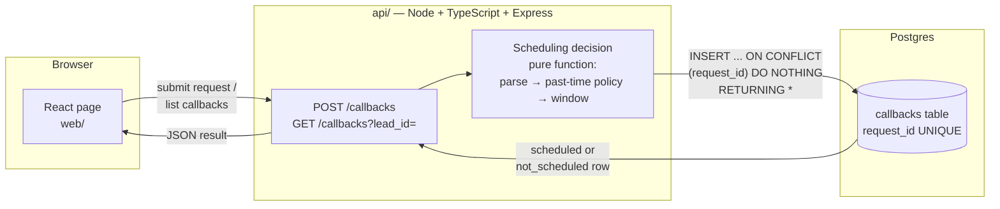

# Architecture

One request flow, three layers. Nothing is actually dialled — storing the scheduled
callback is the end of the flow.

**Why it's shaped this way**

- The scheduling decision (parse text → apply past-time policy → apply calling
  window) is a pure function with no DB and no HTTP. It's the core logic the
  brief is actually testing, so it has to be testable in isolation — see
  `docs/PLAN.md` chunks 2–4.
- "Exactly once" lives at the DB layer: `request_id` is UNIQUE, and the insert
  is `ON CONFLICT (request_id) DO NOTHING RETURNING *`. Two concurrent
  deliveries both race to insert; Postgres serializes them, exactly one wins,
  and the loser's `RETURNING` comes back empty so the API knows to re-read and
  return the winner's row instead. No app-level locking.
- Every outcome — `scheduled` or `not_scheduled` — gets a row, keyed by
  `request_id`. A replay (same `request_id`, any body) always reads back the
  same row instead of re-doing work.

## Data flow for `POST /callbacks`

1. Validate the request body shape (400 if malformed).
2. Try `INSERT ... ON CONFLICT (request_id) DO NOTHING RETURNING *` with the
   *computed* result (parse + window already applied) so the row written is
   final, not re-derived later.
3. If the insert returned 0 rows, a row with this `request_id` already
   exists — `SELECT` it and return that instead (idempotent replay).
4. Respond with the row either way; status code depends on scheduled vs
   not_scheduled vs replay (decided in chunk 6).

## Data flow for `GET /callbacks?lead_id=`

Straight read, ordered by `received_at` or `created_at` (decided in chunk 7),
no side effects.
